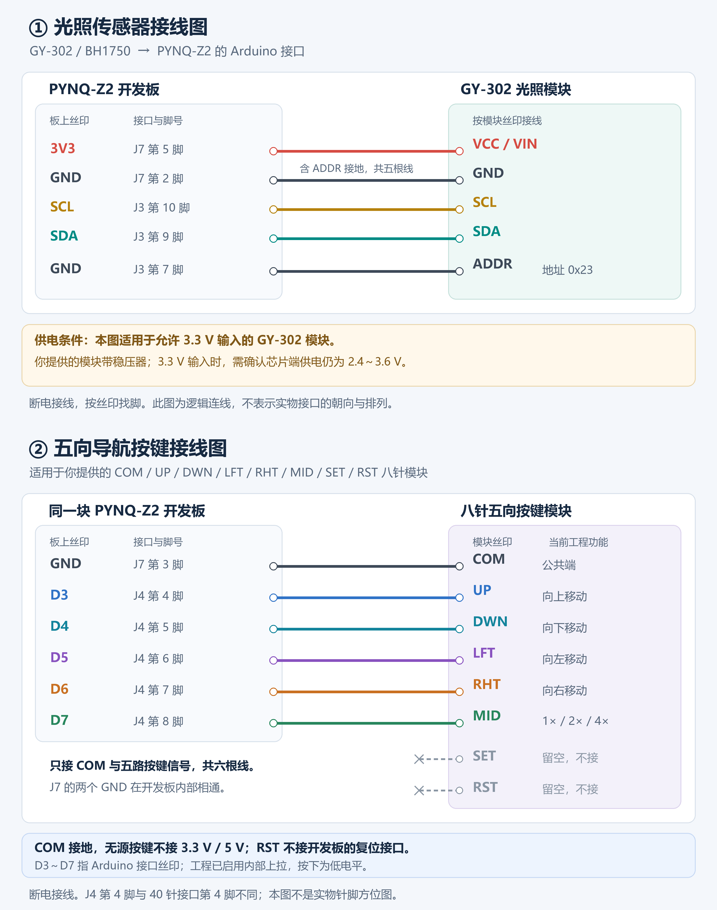

# FPGA Vision：自适应电子视觉辅助器

当前版本是 **2026-10-17 恢复的、加入逆光功能之前的增强版**。提供原图、灰度增强、反色、二值化、彩色增强五种模式。

项目使用 PYNQ-Z2、OV5640 自动对焦摄像头和 HDMI OUT，实现阅读放大、同帧左右对比、ROI 移动、冻结画面及光照自适应。五向导航键和板载按键用于操作；BH1750 已接入。VL53L0X 驱动作为可选功能保留，当前实板未接入验证。

## 获取与运行

在仓库页面选择 **Code → Download ZIP**，或用已获此私有仓库访问权限的 Git 客户端克隆。只需上板时，可直接下载 [配套上板包](delivery/visual_aid_v3_board.zip)。

1. 对照 [接线说明](docs/wiring_zh.md) 和 [完整上板步骤](docs/board_bringup_zh.md) 核对现有模块。
2. 将上板包上传至 PYNQ，在新的父目录解压，保留此前已验证目录。
3. 进入解压生成的 `visual_aid_v3_enhanced`，执行下面的只读预检，再按需启动。

```bash
/usr/bin/python3 preflight.py
sudo /usr/bin/python3 run_board.py --stage live --no-distance --af continuous --io-confirmed
```

同一时间只运行一个使用摄像头/HDMI 的程序；结束前台程序使用 Ctrl+C。自动对焦固件上传并完整回读约需 47 秒，随后开始实时显示。默认请求摄像头 15fps；HDMI 输出 720p/60Hz，二者不能混为视频实测帧率。

## 操作

| 输入 | 功能 |
| --- | --- |
| BTN0 | 五种显示模式循环 |
| BTN1 | 冻结／恢复完整源帧 |
| BTN2 | 同一 ROI 左右对比／全屏 |
| BTN3 | 自动／手动增强策略 |
| 五向上、下、左、右 | 移动查看区域 |
| 五向中心 | 1×／2×／4×数字放大 |



## 工程与环境

| 项目 | 配置 |
| --- | --- |
| 板卡 | PYNQ-Z2，xc7z020clg400-1 |
| 开发工具 | Vivado 2018.3 |
| 板端系统 | PYNQ 2.4，Python 3.6.5，NumPy 1.13.3，OpenCV 3.2.0 |
| 摄像头接口 | OV5640，8bit DVP，RGB565，1280×720 |
| 输出与缓存 | HDMI OUT；DDR 双采集缓冲；BGRX32 交接 |
| 图像处理 | 3×3 条件降噪、15×15 简化局部对比度、双 bank Gamma LUT、轻度锐化 |

`rtl/` 是自定义硬件逻辑；`sim/` 是自检测试台；`software/` 包含板端程序、固件和配套 bit/HWH；`vivado/` 包含框图、约束、实现脚本；`vendor/` 提供本工程引用的第三方 IP 和来源记录；`docs/` 包含接线及架构说明。

## 验证状态

本次发布重新校验了恢复备份，当前 73 个受恢复文件逐字节一致。42 项软件测试、6 项 RTL 快速仿真、Vivado GUI 仿真及框图校验通过。配套原版实现的 WNS 为 **+0.372ns**、WHS 为 **+0.004ns**，DRC 为 **0 Error**；这些是恢复的既有实现结果，本次上传没有重新布局布线。

同一版此前的板端测试已由使用者确认静态 HDMI、彩条、缩放、移动、冻结、模式切换和自动对焦；测量与观察边界见 [实板记录](reports/board_validation_20261017/README_zh.md)。恢复后另行确认了程序启动、采集及显示计数推进。新一轮上传不等于新增实板画质验收。

详细资源、文件指纹、测试范围、其他电脑上的仿真与重建方式见 [本次版本说明](docs/github_release_20261017_zh.md)。原始 [工程操作手册](README_zh.md) 与原始实板记录按快照保留，其“本轮”及进程状态描述属于当时记录；以本页及本次版本说明为当前发布说明。

## 源码验证

在 Windows 的仓库根目录安装主机 Python 依赖（不要安装到 PYNQ 2.4 板端）：

```powershell
python -m pip install numpy opencv-python
python tools/test_software.py
python tools/verify.py --vivado "C:/Xilinx/Vivado/2018.3"
python tools/verify.py --full --vivado "C:/Xilinx/Vivado/2018.3"
.\build.ps1 -Step gui -VivadoRoot "C:\Xilinx\Vivado\2018.3" -PythonExe "C:\Python\python.exe"
```

将示例中的安装目录改成实际位置。GUI 仿真工程由脚本生成，不上传 Vivado 缓存。完整自动打包还有本机旧参考工程的完整性保护步骤，跨电脑使用的约束见版本说明；现成上板包独立可用。

## 许可

本工程新写代码按 [MIT](LICENSE) 发布。第三方 IP、传感器参考驱动和 AF 固件的来源、许可保留于 [THIRD_PARTY.md](THIRD_PARTY.md) 与 `vendor/`。
