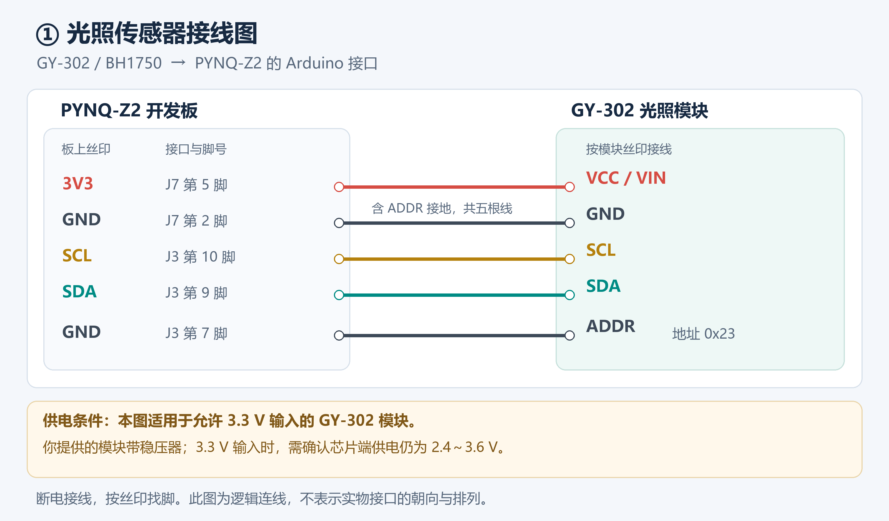
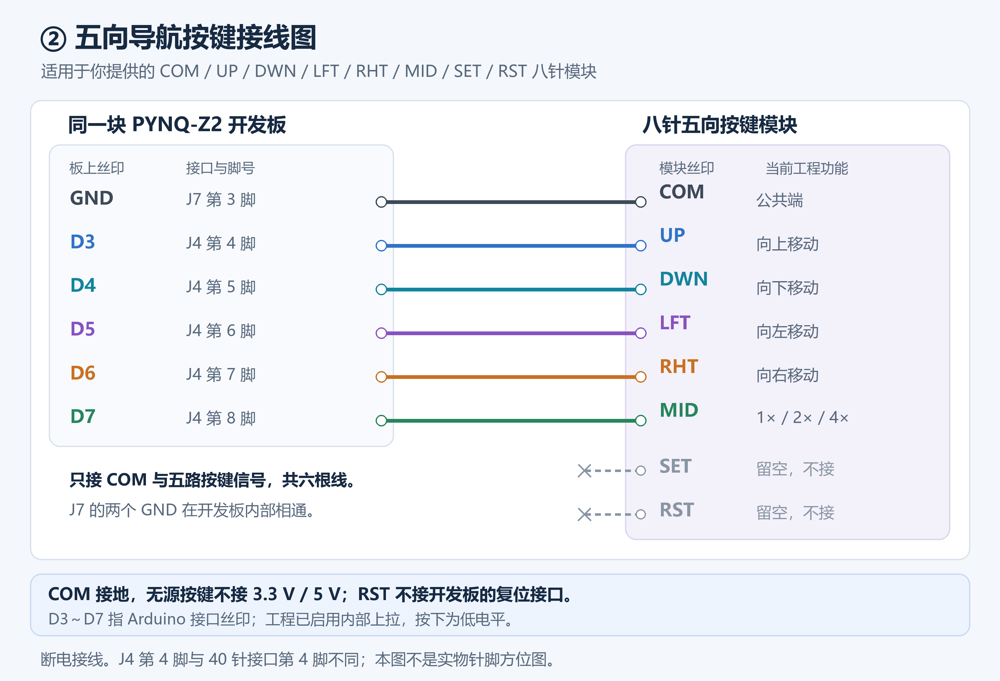

# 光照传感器与五向按键连线图

> 当前为2026-10-28 Arduino光照版：**SCL→J3第10脚/P15，SDA→J3第9脚/P16**，3.3V供电、共地、ADDR接地。
> 本页原图中的Arduino光照信号与当前版本一致；不用历史PMOD B的T11/T10。
> EC11另按 [当前接线](../wiring_zh.md) 使用AR8/AR9/AR10；图示不代表实物插座朝向。

按 `visual_aid_v3` 当前工程分配绘制，适用于 PYNQ-Z2、用户提供的 GY-302/BH1750 光照模块与八针无源五向按键模块。
图是逻辑接线图，不代表插座在实物上的上下朝向。先断电，再按板上丝印、接口编号及 1 号脚标记接线。
`J3 第 9 脚` 表示 Arduino J3 插座的第 9 脚；`D3` 表示 Arduino 数字口 3，均不能按 40 针接口的脚号理解。

| GY-302 模块丝印 | PYNQ-Z2 Arduino 接口 | 说明 |
| --- | --- | --- |
| VCC / VIN | J7 第 5 脚，3V3 | 适用于支持 3.3V 输入的模块 |
| GND | J7 第 2 脚，GND | 电源地 |
| SCL | J3 第 10 脚，SCL | FPGA P15 |
| SDA | J3 第 9 脚，SDA | FPGA P16 |
| ADDR | J3 第 7 脚，GND | 固定为 7 位 I2C 地址 0x23 |

这里为 ADDR 分配一个空闲的接地插孔，不需要在 GY-302 的 GND 引脚上并接两个杜邦线接头。
提供的原理图中 ADDR 已有下拉电阻；该版本也可留空 ADDR，由原有下拉固定地址。

提供的 GY-302 原理图含板载 3.3V 稳压器，但未注明其具体型号。
图中按 3.3V 输入方案绘制；首次使用前应确认此模块支持该供电方式，输入 3.3V 时芯片端供电仍在 2.4～3.6V。
如果该版本要求 5V 输入，应先核对供电方案；不要将 Arduino J7 第 4 脚的 5V5 当作本图 3V3。

| 按键模块丝印 | PYNQ-Z2 Arduino 接口 | 当前功能 |
| --- | --- | --- |
| COM | J7 第 3 脚，GND | 公共端接地 |
| UP | D3，J4 第 4 脚 | 向上移动 ROI |
| DWN | D4，J4 第 5 脚 | 向下移动 ROI |
| LFT | D5，J4 第 6 脚 | 向左移动 ROI |
| RHT | D6，J4 第 7 脚 | 向右移动 ROI |
| MID | D7，J4 第 8 脚 | 循环 1× / 2× / 4× 放大 |
| SET | 不接 | 当前未使用 |
| RST | 不接 | 当前未使用；不是开发板复位信号 |

按键模块共接六根线，不另外接 3.3V / 5V 电源，COM 不接电源正极。
工程为五路输入启用内部上拉，按下接通 COM 后为低电平。
图中 J7 第 2、3 脚与 J3 第 7 脚都是开发板 GND，内部相通。

## 文件

- `01_bh1750_wiring.png` / `.svg`：光照模块图。
- `02_five_way_wiring.png` / `.svg`：五向按键图。
- `bh1750_and_five_way_wiring.png`：两图合并版。
- `draw_sensor_keys.py`：可重复生成图片的脚本；运行前会核对当前 `pins.json` 中的信号管脚。

引脚依据：[PYNQ-Z2 厂家参考手册 v1.1，Arduino 章节，表 16～18](https://dpoauwgwqsy2x.cloudfront.net/Download/PYNQ_Z2_User_Manual_v1.1.pdf)。
模块电路依据项目根目录下用户提供的 GY-302 原理图与五向按键商品图。
本次新增接线资料，没有修改 RTL、约束、软件、bit/HWH 或原项目。
