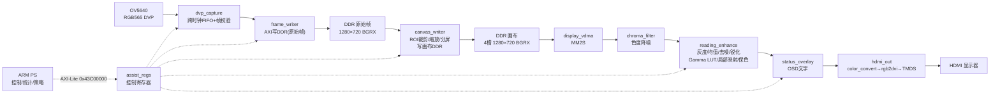

# FPGA Vision 动态视觉增强器 —— 设计架构 · 控制逻辑 · 算法梳理

> 基于提交包 `fpga_vision_submission_complete_20261030.zip`（2026-10-30「dynamic AUTO v3」）。
> 参赛队伍：别急还在学二进制。目标硬件 PYNQ-Z2（xc7z020clg400-1）、OV5640 DVP 摄像头、HDMI、EC11 + 五向键、Arduino J3 接 BH1750（GY-302）。工具基线 Vivado 2018.3 + PYNQ 2.4。
> 本文是对已有 `report/technical_notes/*.md`、RTL 源码与 `src/ps/runtime` 的一次汇总性梳理，细节以源码为准。

---

## 1. 项目概述

FPGAvision 是一个「自适应视觉增强器」原型，定位为电子助视器（相机采集—屏幕放大显示）的可复现 FPGA 实现。核心能力：

- 连续视频下的 **图像增强**（暗光提亮、锐化、去噪、局部明暗补偿、保色）。
- **缩放 + 分屏**（同一源帧复制左右两半，左原图、右增强；1×/2×/4×）。
- **实体控制 + 自动/手动协同**（EC11 旋钮、板载按键、五向键；AUTO 自动调参与手动接管保持）。

软件/硬件分工的原则（引自 `report/related_work.md`）：**PS 管状态与决策（低频），PL 连续处理像素（确定性时序）**。

| 功能 | 实现侧 | 划分依据 | 接口 |
|---|---|---|---|
| DVP 接收、格式/行帧检查、帧存储 | PL | 像素节拍与数据流连续性 | 摄像头并行接口、AXI/DDR |
| 增强、LUT、实时缩放/分屏/文字组合 | PL | 重复逐像素计算、确定时序 | 流数据、寄存器/LUT 双缓冲 |
| HDMI 输出 | PL + 官方视频 IP | 固定显示时序与串行化 | 显示 VDMA、TMDS |
| AUTO 图像统计与策略 | PS | 低频策略调整、便于修改记录 | 只采样 ROI，状态映射寄存器 |
| 网页/按键/编码器事件与模式切换 | PS 为状态拥有者 | 统一命令顺序、手动优先规则 | 网页邮箱、采样事件、控制寄存器 |

关键工程指标（60 秒板端运行，`board/results/`）：采集 1199 帧 / 19.980 FPS，渲染 1176 帧 / 19.622 FPS；DMA 错误、溢出帧、坏帧增量均为 0；AUTO、手动接管保持、恢复 AUTO、冻结/恢复全部通过。

---

## 2. 系统总体架构

### 2.1 Block Design（`src/pl/vivado/create_system.tcl`）

独立的 BD 只保留：**PS7 + DDR + 官方 HDMI OUT + 自定义 `assist_core`**。不复用旧工程的 MicroBlaze IOP、USB 摄像头入口、HDMI 输入。

- `ps7_0`：FCLK_CLK0=100MHz 作为全系统时钟；开启 Fabric 中断 `IRQ_F2P`（但软件用轮询，见 4.6）。
- 两条 AXI 互联：
  - `control_bus`（7 个 Master 口，AXI-Lite 控制总线，接 `M_AXI_GP0`）→ `assist_core/s_axi`、`display_vdma/S_AXI_LITE`、`hdmi_out` 的 5 个 AXILite 口。
  - `memory_bus`（3 SI → 1 MI，接 `S_AXI_HP0` 高性能口）→ 三个数据主：`assist_core/m_axi`（原始帧写）、`display_vdma/M_AXI_MM2S`（读画布）、`assist_core/m_canvas`（读原始帧→写画布）。
- `display_vdma`：仅 MM2S、4 个 framestore、64bit 数据位宽。
- `hdmi_out` 层级：官方 `color_convert`（HLS 导出）→ `pixel_unpack` → `rgb2dvi`（TMDS）→ `axi_dynclk`。
- **增强链插入点**：显示 VDMA 的 `M_AXIS_MM2S` 经过 `axis_register_slice` 后进入 `assist_core/s_axis`，从 `assist_core/m_axis` 出来再进入 `color_convert/stream_in_24`。也就是说 **所有送显画面都经过 PL 增强链**。

### 2.2 数据通路总览

文字描述（对齐 `report/technical_notes/architecture_zh.md`）：

> OV5640 RGB565 字节流 → DVP 校验 / Gray 指针跨时钟 FIFO → 自定义 AXI 写 DDR（原始帧）→ PL 独立读同一源帧做 ROI/缩放/双份画布 → HDMI MM2S VDMA → FPGA 阅读增强（色度降噪→亮度/边缘增强→局部映射→保色重建→OSD）→ 官方 HDMI OUT。

### 2.3 两条合成路径（画布从哪来）

当前部署默认 `--pipeline pl`；`--pipeline cpu` 作为旧版对照与回退保留。

- **PL 画布（当前默认）**：`canvas_writer` 由 PL 独立读取已完成的原始帧，做 ROI 裁剪、2×2 盒式缩小（分屏 1×）、整数最近邻放大（2×/4×）、左右复制同一 ROI，写入独立画布 DDR。下一帧采集与上一帧画布渲染并行，缩放模块 **不反压摄像头采集**。
- **CPU 合成（旧）**：ARM 用 `compose()` 在内存里做同样的裁剪/缩放/分屏。

两条路径最终都经 VDMA 送入同一条 PL 增强链。`src/pl/software` 是硬件验证的固定参考模型与历史 PS 基线；实际部署用 `src/ps/runtime`（两者用途不同，README 有说明）。

### 2.4 缓冲与所有权模型

- 原始帧：2～3 块 720×1280×32bit **可缓存 CMA**，64 字节对齐；CPU 视图只读，分配时 flush 一次，每次 PL 写完后 invalidate 再读。
- 画布：4 块 CMA 画布 + `ParkedScanout` 显式管理所有权；正在显示、等待显示、冻结源均不可覆盖。
- 采集与显示相互独立计数（`capture_id` / `render_count` / `display_count`）。

---

## 3. PL 数据通路与控制

`assist_core`（`src/pl/rtl/visual_aid_core.sv`）内部由以下子模块组成。

### 3.1 `dvp_capture` —— 采集域（pclk）

- RGB565、高字节在前；VSYNC 高有效消隐、HREF 高有效。传感器 `0x4740[5]=1` 在 PCLK 下降沿更新数据，故 **在 PCLK 上升沿统一采样到 IOB 寄存器**，下一周期再处理。
- FIFO 字（28bit）：`[27]` 帧结束令牌、`[26]` 该帧有效、`[25]` 像素行尾、`[24]` 像素帧首、`[23:0]` BGR888。
- **帧结束只在下一个 VSYNC 才被认证**：多余行/字节不会把损坏的最后一帧发布出去。
- 传感器无法暂停；FIFO 满时丢弃余下帧。溢出/格式异常丢弃该帧余下部分，DMA 永远不发布缺标记的帧。
- HREF 检查字节成对与宽度；行数在下一次 VSYNC 确认；多余像素/行判为坏帧。
- 跨时钟用 **Gray 码指针 FIFO**（`async_fifo`），先寄存 Gray 码再跨域，避免组合逻辑毛刺。

### 3.2 `frame_writer` —— 原始帧 DMA

- 单次 DMA，**16 拍 × 32bit INCR burst**（不跨 4KiB）；目的地址 64 字节对齐，WIDTH×HEIGHT 须为 16 的倍数。
- CPU 拥有完成缓冲直到下一次显式 start；**不完整/出错帧绝不置 done**。
- 最后一个像素 AXI B 响应成功 + 收到正确帧结束令牌，才置 done、`frame_id++`。
- 软件停止**不能单独复位 AXI 主**：把已提出的 AW、完整发完 16 拍 W 并等 B 响应期间保持 busy=1，busy 归零后才释放缓冲。

### 3.3 `canvas_writer` —— 画布渲染（缩放/分屏）

- 读原始帧 → 2×2 盒式低通缩小（分屏 1×）、整数最近邻放大（2×/4×）、左右复制同一 ROI、保留宽高比留黑边，写 1280×720 画布。
- 读突发限制在一行内与 4KiB 页边界；写 16 拍 × 64bit。
- 关键点：**缩放不反压 DVP 采集**，通过独立 start 寄存器与独立源地址解耦。

### 3.4 `frame_tiles` —— ROI 分块统计（8×6）

- 每采集帧统计一次（不是每次 HDMI 重复），8×6=48 块灰度累加和。
- 双 bank，只有收到有效 EOF 且流水线排空后才发布；CPU 侧有镜像 `cpu_sums` 避免第三个 BRAM 口。
- 坐标比较用有界比较器，避免 RAM 地址路径上的全宽常数除法。

### 3.5 显示链（AXIS 流，100MHz 域）

顺序：`chroma_filter`（色度降噪）→ `reading_enhance`（含 `local_tone_map` + `color_reconstruct`）→ `status_overlay`（OSD）→ `hdmi_out`。

- **SOF 原子锁存**：所有配置（cfg/quality/gamma bank）只在被接收的 SOF 切换，帧中不变。
- **反压冻结**：所有流数据 / sideband / 行状态在输出反压时整体冻结；流水线各级使能位一起随 `advance` 推进。
- **分屏独立窗口**：左右两半在接缝处各自重启水平窗口，不跨缝做均值/边缘。

### 3.6 寄存器映射（`assist_regs.sv`，基址 0x43C00000）

控制基址 0x43C00000，显示 VDMA 基址 0x43000000，ABI `0x56410400`。

| 偏移 | 方向 | 内容 |
|---|---|---|
| 0x00 | R | ABI `0x56410400` |
| 0x04 | R/W | bit0 采集域使能；0 清空采集/FIFO 并让写入器完成在途事务后停止 |
| 0x08 / 0x0c | R | 默认宽 1280 / 高 720 |
| 0x10 / 0x14 | W | 目的物理地址（64B 对齐）/ bit0 启动单帧 |
| 0x18 | R | bit0 busy、bit1 done、bit2 error |
| 0x1c / 0x20 | R | 正确完成帧序号 / DMA 错误次数 |
| 0x24 / 0x28 / 0x2c | R | VSYNC 次数 / 溢出帧数 / 格式异常帧数 |
| 0x30 | R/W | 阅读配置（位域见下） |
| 0x34 | R | 显示输入 SOF 次数 |
| 0x38 | R | [3:0] 板载按键，[8:4] 上下左右中，归一按下=1 |
| 0x3c / 0x40 | W/R | [3:0] 两路总线 SCL/SDA 释放=1、[4] RESET_N、[5] PWDN / 实际输入采样 |
| 0x44 / 0x48 | W | [7:0] LUT index、[15:8] value，写非活动 bank / bit0 commit |
| 0x4c | R | bit0 pending、bit1 当前 bank |
| 0x50 / 0x54 | R | EC11 累计计数 / 稳定 A/B 与按下状态 |
| 0x58 / 0x5c / 0x60 | R | 短按计数 / 长按计数 / 非法正交跳变计数 |
| 0x68 / 0x6c / 0x70 | W | 画布目的地址 / ROI（[10:0]x [25:16]y）/ view_cfg |
| 0x74 | R | 画布渲染状态（busy/done/error） |
| 0x78 | R/W | quality_word（位域见下） |
| 0x7c | R | PL 画布特征签名 `0x504c0002` |
| 0x80 / 0x84 / 0x88 / 0x8c | W/R | tile 读索引 / tile 累加和 / 采样数 / 发布帧 id |
| 0x90 / 0x94 / 0x9c | W/W/R | 局部增益 index/value（写非活动 bank）/ commit / pending |
| 0xa0 / 0xa4 / 0xa8 / 0xac | W | OSD 字符 / 提交 / 使能 / pending |
| 0xb0 / 0xb4 / 0xb8 | W | 显示槽选择 / 槽配置（双缓冲）/ 当前硬件显示槽 |
| 0xc0 / 0xc4 | W | 画布源地址（原始帧）/ 启动画布渲染 |

**cfg_word（0x30）位域：**

| 位 | 含义 |
|---|---|
| [2:0] | 模式：0 RAW / 1 灰度 / 2 反色 / 3 二值 / 4 彩色 |
| [3] | 分屏（左半旁路显示原图） |
| [4] | 3×3 降噪使能 |
| [5] | 锐化使能 |
| [7:6] | 局部对比度（detail）强度 |
| [15:8] | 二值化阈值偏移 C |
| [16] | Sobel/边缘诊断视图 |
| [20:17] | 降噪档位（V4） |
| [24:21] | 锐化噪点抑制阈值档位（V4） |
| [28:25] | 锐化增益（V4） |
| [30:29] | 算法：0 OFF / 1 USM / 2 Laplacian / 3 GUIDED（V4） |
| [31] | 高级处理使能（V4） |

**quality_word（0x78）位域：**

| 位 | 含义 |
|---|---|
| [0] | 保色补偿使能 |
| [5:1] | 保色强度 0..16 |
| [6] | 二值化大窗口 31×31 |
| [7] | 局部明暗映射使能 |
| [8] | PL 色度降噪使能 |

---

## 4. 控制逻辑

### 4.1 输入设备

**EC11 旋钮（`encoder_input.sv`，PL 内解码）**
- A/B：100µs 稳定滤波，只接受合法 Gray 状态转移，**一个完整正交周期计 1**。
- KEY：25ms 消抖；短按释放与 1 秒长按分别计数。
- ARM 只读累计计数，不做软件消抖。接线：S1→J3-1（V17）、S2→J3-2（V18）、KEY→J3-3（T16）。

**板载按键 + 五向键**（PS 软件消抖，`controls.py`，25ms）

| 输入 | 功能 |
|---|---|
| BTN0 | RAW→GRAY→INVERSE→BINARY→COLOR 循环 |
| BTN1 | 冻结 / 恢复 |
| BTN2 | 左右对比 / 全屏 |
| BTN3 | 自动 / 手动增强 |
| 五向 上/下/左/右 | 移动查看区域（放大后更明显），0.35s 后 0.09s 连发 |
| 五向 中心 | 1×/2×/4× 循环 |

**EC11 参数编辑（短按切换 / 旋转调值 / 长按恢复默认）**

| 顺序 | 项目 | 范围（默认） |
|---|---|---|
| 1 | BRIGHTNESS | -10～10（0） |
| 2 | SHARPNESS | 0～10（4） |
| 3 | DENOISE | 0～10（4，0 关闭） |
| 4 | CONTRAST | 0～3（1） |
| 5 | ALGORITHM | OFF/USM/LAPLACIAN/GUIDED（3） |
| 6 | NOISE | 0～10（4） |
| 7 | EDGE VIEW | OFF/ON（0） |
| 8 | COLOR | 0～16（0） |
| 9 | LOCAL TONE | OFF/ON（0） |
| 10 | WINDOW | 15/31（0） |
| 11 | BINARY C | 0～32（8） |

### 4.2 PS 状态机（`controls.py` 的 `State`）

状态：`mode`、`zoom`、`center`、`frozen`、`split`、`automatic` + 11 个画质参数。旋转/修改任何 AUTO 联动参数会自动切入手动（`set_automatic(False)`）；长按恢复画质预设但**不重置缩放/冻结/自动状态**。三个画质预设：`baseline`（不启用保色/局部映射/31×31/PL 色度降噪）、`balanced`（强降噪）、`detail`（弱过滤、保弱笔画，默认）。

### 4.3 AUTO 自动策略

AUTO 是纯软件（PS）策略，复用现有 PL 查表/寄存器硬件，不新增 PL 资源。

**`AdaptivePolicy`（`local.py`）—— 自适应 Gamma LUT**
- 采样源 ROI（最多约 160×90 点），算均值与第 60 百分位 `level = 0.5·mean + 0.5·p60`。
- 暗度 `darkness = clip((144-level)/112, 0, 1)`；指数 `exp = clip(1-(0.74+0.12·ambient)·darkness, 0.35, 1.0)`；ambient 来自 BH1750 有效 lux（`clip((100-lux)/100,0,1)`）。
- **在灰度 224 处锚定原曲线**（224 及以上保持不变），近黑增益上限 5×（`stable` 档降为 3×）。
- 时间平滑（指数 `α = 1-exp(-dt/τ)`，τ≈0.6s / stable 2s）；`stable` 档每次更新最多变 1 个亮度级。

**`AutoQuality`（`auto_quality.py`）—— 场景指标 + 有界调参**
- 9 个 24×24 连续 patch（5184 像素，保留邻接以便估噪/边缘），≤2Hz 更新。
- 指标：均值、暗部占比、高光占比、对比度范围（p90-p10）、噪声 σ（MAD×1.4826/1.118）、边缘占比、光照不均度、lux。
- 由这些指标推出：降噪、锐化、噪声阈值、对比度、保色强度、二值阈值、局部映射开关、窗口大小，算法固定为 GUIDED。
- **单调有界更新**：整数参数每秒最多 ±1 步，避免启动跳变；局部增益从 1.0 起步、每次变化 ≤2/256。

**`TilePolicy`（`local.py`）—— 局部明暗增益（8×6 tile）**
- 由 PL `frame_tiles` 的 48 块均值算出目标增益 `gain = clip((target+32)/(mean+32), 0.75, 1.5)·256`，3×3 空间平滑去接缝 + 时间平滑；近黑与高光不加局部提亮。

**手动接管**：BTN3 或旋转 AUTO 参数即切手动（恒等 LUT 为基准）；BRIGHTNESS 作为用户偏好叠加，自动策略不覆盖用户值。

### 4.4 冻结 / 缩放 / 分屏

- 冻结：复制完整源帧、锁定源缓冲（`pinned_raw`），只在此后平移/缩放该冻结视野时由 ARM 重新生成冻结画布；摄像头继续在其他缓冲采集。
- 缩放/分屏在画布合成阶段完成；ROI 移动由五向键改 `center`，按 zoom 缩放步长并做边界 clamp。

### 4.5 主循环时序（`pl_runtime.run_pl`）

每帧循环：`dev.finish(rearm=True)`（先提交另一块缓冲，再 invalidate 当前帧）→ 轮询网页/旋钮/按键 → 传感器快照 → 若 AUTO 到期则 invalidate 缓冲后采样 9 patch 更新策略 → 冻结/实时状态切换 → `queue_render`（实时）或冻结画布重合成 → 写 `quality_word` → 每 250ms 更新 tile 统计与局部增益 → 更新 Gamma LUT / 局部增益（带 pending 检查）→ 每 250ms 更新 OSD 状态文字 → 每 15 帧输出 JSON 采样。

显示侧用 **带超时的 MM2S 状态轮询**等待新显示帧（`_PollingFrameReady`），不实例化 AXI 中断控制器，避免 PYNQ 2.4 对 INTC 的依赖。

---

## 5. 算法介绍

所有窗口算子统一采用**因果（尾随）窗口**约定：窗口中心在当前坐标的前一行/前一列，不足窗口边界回退到当前像素，不读未初始化 RAM。均用**整数倒数乘法**代替除法，逐像素与 Python 参考模型（`image.py`）位精确一致。

### 5.1 灰度与整数倒数

- 灰度：`gray = (77·R + 150·G + 29·B) >> 8`（Rec.601 亮度近似）。
- 除法：`floor(n/9) = (n·7282)>>16`，`floor(n/225) = (n·149131)>>25`（15×15），31×31 用 `(n·139665)>>?`（大窗口）。系数在输入全域核对过。
- 关键路径不做取模：行缓冲用环形行计数（`ring15`/`ring3`）；坐标查表 ROM 替代常数除法进位链。

### 5.2 3×3 去噪（`reading_enhance`）

`base = (denoise && |gray - mean3| ≤ 阈值) ? mean3 : gray`。默认阈值 12 级，V4 高级档阈值 = denoise_level×3。只在像素与 3×3 均值相差不超过阈值时平滑，**保护细字边界**。

### 5.3 局部均值与细节项

- 尾随 15×15 均值（二值大窗口为 31×31）。
- 细节项 `detail = (base - mean15) · local_strength[7:6]`，`>>2` 后叠加（局部对比度）。

### 5.4 锐化（V4，`[30:29]` 选算法）

- **USM**：`signal = gray - mean3`。
- **Laplacian**：`signal = lap >> 2`（3×3 中心 4 邻域响应，窗口中心在前一行/前一列）。
- **GUIDED**：Sobel 响应 `edge = (|gx|+|gy|)>>3` 门控 + 细节阈值：弱变化（`edge ≤ noise·4` 或 `|signal| ≤ noise·2`）置 0；强边缘（`edge ≥ noise·4+24` 或 `edge>160`）减半；最终增量 `finish_sharp` 限幅 **±24 级**。
- 增益 `[28:25]` 经 DSP 乘法，`product>>>3` 后 ×4 回比例。
- 这些是对应的工程化「边缘引导锐化」，不宣称逐式复现 Guided Image Filtering 论文（related_work 有说明）。

### 5.5 Gamma LUT 暗光提亮（`reading_enhance` 双 bank）

- 256 项（512 物理表双 bank）；ARM 在非活动 bank 写，commit 后只在**被接收的 SOF** 切换，pending 时禁止覆写；切换后 `bank_guard=11` 保护期等旧帧像素完成查表。
- LUT 由 `AdaptivePolicy` 生成（见 4.3），是源 ROI 经 CPU 查表的**亮度估计**，非 HDMI 实测。

### 5.6 局部亮度映射（`local_tone_map`）

- 8×6 有界 tile 增益（192..384，即 0.75～1.5×），仅改亮度，色彩随后在保色阶段恢复。
- 像素级在相邻 tile 中心间**双线性插值**；坐标 ROM 实现 `floor(x·256/tile)-128`。
- 修正 `correction = target_y·(gain-256)>>8`，限幅 ±24；权值 `weight = min(shadow_weight(source), light_weight(target))`（近黑 `source<24` 与高光 `target>224` 渐弱）。
- 这是有界分块 tone mapping，**不是**完整 CLAHE（无局部直方图限幅重分布）。

### 5.7 色度降噪（`chroma_filter`）

- 因果 3×3 色度均值滤波，**保留当前像素亮度**。
- 门控：仅在亮度差 ≤ strength×3 且 `|diff_r-diff_g| ≤ strength×6+8`、`|diff_b-diff_g| ≤ strength×6+8` 时滤色，避开明显颜色边界；原始对比侧（左半）与 RAW/诊断模式旁路。
- 空间降噪，无运动补偿/帧融合。

### 5.8 保色重建（`color_reconstruct`）

- `chroma = raw - source_y`；`lift = max(target_y-source_y, 0)`；共同增益 `gain = 32 + min(lift>>2, boost)`（source<16 时 boost 限 4）。
- 先检查整个 RGB 三元组是否色域内（预移位边界），统一压缩色度而非逐通道裁剪：`candidate → one_fits → half_fits → 灰度` 四级回退，中性灰不被染色。
- 模式输出：灰度=Y、反色=255-Y、二值=0/255、彩色=重建、RAW=原样旁路；Sobel 诊断视图在非 RAW 模式输出 `{3{edge}}`。

### 5.9 二值化

`binary = base < (mean15 - C) ? 0 : 255`；窗口 15×15 或 31×31（`quality[6]`），C=`cfg[15:8]`；窗口不完整时回退阈值 128。尚未实现居中窗口或 Sauvola 方差阈值。

### 5.10 OSD 文字（`status_overlay` + `status_font`）

- 6 行 × 64 字符，5×7 点阵 2× 放大；CPU 双 bank 写字符、SOF 提交；无帧缓冲、无逐帧 CPU 合成。显示 EDIT 参数、FPS、LUT 估计、AUTO 状态等。

### 5.11 EC11 正交解码

100µs 稳定滤波 + 合法 Gray 转移表；`quarter` 累积 4 个 1/4 周期 = 1 计数；非法跳变单独计数（`invalid_count`）。KEY 25ms 消抖，短按释放与 1 秒长按分列计数。

---

## 6. 摄像头与传感器（PS 侧）

- **OV5640**（`camera.py`，SCCB 地址 0x3c）：720p RGB565，DVP ≤84MHz；FPS 档 15..30（PLL 分频 + HTS 行消隐）；`0x4740=0x20` 下降沿送数；色条 `0x503d=0x80`；50Hz 防频闪寄存器；稳定曝光（50Hz 环境）；画质预设改 ISP 边缘强度；自动对焦固件（`ov5640_af.bin`）分块上传并**逐字节读回校验**后才执行，命令 ACK 仅表示应答，不等于光学对焦成功。
- **BH1750**（`sensors.py`，0x23）：连续高分辨率模式，`lux = raw/1.2`。
- **VL53L0X**：后台带超时采集，8190/8191 等超量程值判空；缺失/超量程记 `None`，**不把错误数据当自动控制输入**。

---

## 7. 验证与证据边界（`report/evidence_index.md`）

- XSim 覆盖自定义 RTL（9 组完整分辨率），不仿真 PS/Linux/真实 DDR/镜头/HDMI 显示器；行为级 AXI 存储模型只验证数据与协议，不证明真实带宽/板上 FPS。
- 完整系统 BD 校验不证明时序/DRC/HDMI 物理显示；布局布线、CDC/输入时序审核、静态 HDMI、彩条、真实场景与稳定性须另行测量。
- 129 项软件测试、9 项技能校验、从零构建 bit/HWH 全部通过（建立裕量 +0.189ns、保持 +0.014ns、DRC 0）；新旧 bit 配置数据逐字节一致。
- 未定量验证项（README 明确列出）：同场景 AUTO 开/关速度差、端到端延迟/功耗、光学对焦重合时间、临床阅读改善；未申报「跨板验证」。

---

## 8. 关键文件索引

| 主题 | 位置 |
|---|---|
| 总览与验证入口 | `README.md` |
| 数据通路与证据边界 | `report/technical_notes/architecture_zh.md` |
| PL 图像链路升级 | `report/technical_notes/pl_upgrade_zh.md` |
| EC11 与边缘锐化 | `report/technical_notes/upgrade_ec11_zh.md` |
| 暗光提亮 | `report/technical_notes/lowlight_20261020_zh.md` |
| 控制操作（当前版） | `report/technical_notes/controls_current_zh.md` |
| 应用背景与软硬件划分 | `report/related_work.md` |
| 优化与可比性 | `report/optimization.md` |
| 复现操作 | `report/reproduction.md` |
| 顶层 RTL | `src/pl/rtl/visual_aid_core.sv` |
| 增强核心 | `src/pl/rtl/reading_enhance.sv`、`local_tone_map.sv`、`color_reconstruct.sv`、`chroma_filter.sv` |
| 采集/存储/画布 | `src/pl/rtl/dvp_capture.sv`、`frame_writer.sv`、`canvas_writer.sv`、`frame_tiles.sv`、`async_fifo.sv` |
| 寄存器 | `src/pl/rtl/assist_regs.sv` |
| 编码器/OSD | `src/pl/rtl/encoder_input.sv`、`status_overlay.sv`、`status_font.sv` |
| BD 脚本 | `src/pl/vivado/create_system.tcl` |
| 约束 | `src/pl/vivado/pins.xdc`、`cdc.xdc` |
| PS 运行时（部署） | `src/ps/runtime/run_board.py`、`visual_aid/{device,pl_runtime,controls,auto_quality,local,camera,sensors,scanout,image}.py` |
| 参考模型（历史） | `src/pl/software/`、`src/pl/tests/` |
